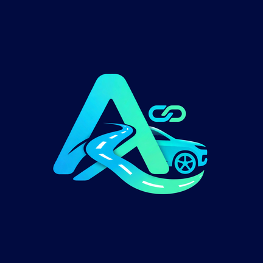
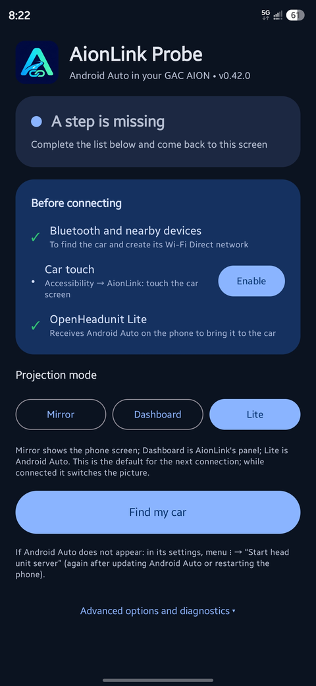
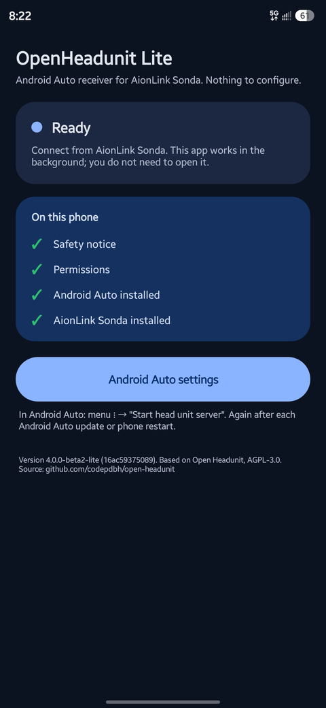

<p align="center">
  
</p>

<h1 align="center">AionLink Open X</h1>

<p align="center">
  <strong>Android Auto and your phone's screen in a GAC AION with ICCOA CarLink.</strong><br />
  An independent, open-source Android client. No root, no manufacturer apps.
</p>

<p align="center">
  <a href="LICENSE"></a>
  
  
  
  <a href="docs/PROGRESS.md"></a>
</p>

<p align="center">
  <a href="#what-it-does">What it does</a> ·
  <a href="#status">Status</a> ·
  <a href="#using-it">Using it</a> ·
  <a href="#building">Building</a> ·
  <a href="#how-it-works">How it works</a> ·
  <a href="#documentation">Documentation</a>
</p>

---

## What it does

The GAC AION i60 only offers **ICCOA CarLink**, a Chinese projection protocol
that international phones do not include. AionLink Open X implements the phone
side of that protocol with public Android APIs and brings to the car:

- **Android Auto**, via [OpenHeadunit Lite](#openheadunit-lite), with the
  phone screen off.
- **The phone screen** (mirror mode), with touch and sound.
- **An own panel** with a clock, music, and Maps or Waze directions, also with
  the screen off.
- **Quick reconnect**: after the first pairing, later connections skip the
  code — the phone keeps a stored key for the car and proves it instead of
  asking for a PIN.
- **Car watch and mode picker**: the app watches in the background for the
  car and notifies when it is near; the home screen picks the projection
  mode (Mirror, Dashboard, or Lite) for the next connection.
- **Auto-reconnect after a drop**: if a live session ends unexpectedly, the
  app retries by itself with QUICK (no code), up to 3 attempts, then falls
  back to the car watch.

```text
Galaxy S25 Ultra                                              GAC AION i60
┌────────────────────────────┐   Wi-Fi Direct + ICCOA    ┌──────────────────┐
│ Android Auto               │                           │                  │
│   ↓ (head unit server,     │   H.264 video 1920x960    │  CarLink         │
│      local)                │ ────────────────────────► │  screen          │
│ OpenHeadunit Lite          │   AAC audio 48 kHz        │                  │
│   ↓ surface + audio        │                           │                  │
│ AionLink Open X ───────────┼──◄────── touches (UIBC) ───┤                  │
└────────────────────────────┘                           └──────────────────┘
```

Reference vehicle: **GAC AION i60 REEV Platinum** (ADiGO unit, firmware
`GAC_T51_IDC_S003_260310_0742921_R`). Reference phone: international **Samsung
Galaxy S25 Ultra** with Android 17.

<p align="center">
  
  &nbsp;&nbsp;
  
</p>

## Status

Each row says **how** it was checked: in the car, only on the phone, or by
owner report. The detail with hashes and dates is in
[docs/PROGRESS.md](docs/PROGRESS.md).

| Feature | Status | Evidence |
|---|---|---|
| ICCOA session: BLE, Wi-Fi Direct, AUTH, CONTROL, RTSP | ✅ Works | On the AION since 0.25 |
| Mirror 1920x960 at 30 fps with AAC audio | ✅ Works | On the AION with 0.34: 11 Mbps, 31 fps, 6175 AAC frames; sound reaches the car, and the phone is not muted |
| Mirror touch | 🟡 Partial | Video and audio work, but the owner reports touch mostly does not work: taps outside the middle strip are dropped when the phone is portrait, and the "Car touch" accessibility service must be on |
| Android Auto via OpenHeadunit Lite (video, audio, reconnection) | ✅ Works | On the phone (0.42): 24–28 fps, real audio, 5/5 reconnections; video streaming in the car on 2026-11-17 (build 45), touch confirmed |
| Android Auto with the screen off | ✅ Works | On the phone: stable 20 fps with the screen off |
| Android Auto touch in the car | ✅ Works | On the AION (build 45): 233 touches applied, 0 dropped in one session; 794 applied of 796 in a longer one. Lite logs every bridge touch (OPENHU tag) |
| Steering wheel next/previous in Android Auto | ❌ Car limitation | Timed presses in the car (2026-11-17) produced no UIBC key event and no CONTROL custom_key_event at all: the i60 routes the wheel to its own player and never sends the presses to the phone. The forwarding code is complete (bridge KEY=4 → Android Auto) and would work if the car ever sent them; nothing more can be built on the phone side |
| Quick reconnect without the code (QUICK) | ✅ Works | Proven in the car 2026-11-16 and 2026-11-17: the i60 accepts QUICK from AionLink (3 for 3, then again on later sessions). First connection saves the key, later ones skip the code; any failure falls back to the PIN dialog |
| Auto-reconnect after a drop | ✅ Implemented | Built 2026-11-17 (build 47): if a live session ends unexpectedly (network error, car closes it, P2P drop) the app retries by itself with QUICK, max 3 attempts (right away, +15 s, +45 s), then falls back to the watch; never on a user Stop. Awaiting a car test of a real drop |
| Car watch and projection mode picker | 🟡 Partial | Watch notifies when the car is near and restarts itself after a disconnect, an app update, and a phone restart (builds 44–45). It opens the app by itself only with the full-screen alert permission granted and the screen off or locked; with the phone awake it shows a banner. Mode picker works (Lite default); mid-session switch applies on the next PLAY |
| Own panel with the screen off | 🟡 Implemented | Encoding measured 10 min on the phone |
| Wired USB/AOA connection | 🧪 Experimental | No authentication with the AION |

No compatibility with other vehicles or phones is claimed. Published versions
are research builds (`-research`).

## Using it

### What you need

1. **AionLink Open X** (`org.aionlink.open.lab`), built from this repository.
2. **OpenHeadunit Lite** (`org.aionlink.headunit.lite`), built from the `main`
   branch of [our Open Headunit fork](https://github.com/bunthoeurndim/open-headunit),
   which carries the AionLink surface bridge and touch tracing.
3. **Both signed with the same key.** The bridge between them uses the
   `signature` permission
   `org.aionlink.headunit.lite.permission.AIONLINK_SURFACE`; with different
   keys, Android does not let them talk to each other. Install Lite first, as
   it is the one that defines that permission. Lite shares neither package nor
   permissions with full Open Headunit: both can be installed, and AionLink
   only uses Lite.
4. **Android Auto** with developer mode on. In its settings, menu ⋮ →
   **Start head unit server**. Repeat after every Android Auto update and
   every phone restart.

### First time on a phone

Open **AionLink Open X**. If something is missing, the **Before connecting**
card shows it with a button to fix it:

- **Bluetooth and nearby devices**: to find the car and create its Wi-Fi Direct network.
- **Car touch**: the accessibility service that applies the car screen's
  touches. Android may turn it off when the app updates; if that happens, the
  card reappears.
- **OpenHeadunit Lite** installed.

Open **OpenHeadunit Lite** once, read and accept the safety notice, and grant
the permissions. From then on it works in the background; there is nothing to
configure.

### Connect

1. With the car **parked**, open CarLink on the car screen.
2. In AionLink Open X tap **Find my car** and then **Connect** next to the receiver.
3. Enter the code the car shows (first pairing only — later connections skip
   it; see [Reconnecting without the code](#reconnecting-without-the-code-quick)).
4. Android Auto appears on the car screen. You can turn off the phone screen.

In mirror mode, tap **Prepare screen and audio capture** before connecting,
or the car closes the session about 10 s in.

### Reconnecting without the code (QUICK)

The first connection with a code creates a long-term key for the car on the
phone and stores the car's key. From the second connection on, the app
connects without showing the code dialog. If the car rejects the saved key,
the app deletes it and asks for the code exactly as before — the fallback is
the normal flow, not an error. The diagnostics export shows how many saved
keys the phone holds (`Quick connect: saved keys=N`). Proven in the car: the
Aion receiver accepts a saved key from AionLink — the second and later
connections skip the code (verified 2026-11-16 and 2026-11-17).

### Car watch and projection mode

- **Car watch** (Advanced options → Automatic connection): the app watches in
  the background for the car's ICCOA advertisement and notifies when it is
  near. Tapping the notification opens the app, prepares the connection, and
  opens the code dialog with automatic AUTH pre-checked. The notification
  opens the app by itself only when the full-screen alert permission is
  granted (Advanced options offers the button when it is not) and the phone
  screen is off or locked; with the phone awake, Android shows a banner
  instead. The watch resumes after a disconnect, an app update, and a phone
  restart.
- **Projection mode** (home screen): Mirror, Dashboard, or Lite is the
  default for the next connection (Lite is the default). Switching mode in
  the middle of a session stops only the video stream; the new mode applies
  when the car next sends PLAY, with no new PIN.

Mirror and panel modes, image quality, car-free tests, the USB connection, and
diagnostics export are under **Advanced options and diagnostics**.

> **Safety:** do not handle the phone or the app while driving. New tests are
> done with the car parked.

## Building

### Requirements

- Windows with Android Studio (its JDK, in `jbr`) and the Android SDK.
- Python 3 for the analysis tools and tests.

Pinned versions: **Gradle 8.13**, **AGP 8.9.1**, **Kotlin and Compose 2.1.20**,
minSdk 29, compile/target SDK 35.

GitHub Actions also builds the Open X debug APK automatically on every push and
pull request (`.github/workflows/build-apk.yml`): it runs the Python and JVM
unit tests, then builds AionLink Open X and uploads it as the
`aionlink-open-x-apk` artifact. The build is signed with the shared key (see
below), so it installs over the app already on the phone; the workflow
verifies the APK carries that key.

### AionLink Open X

```powershell
git clone https://github.com/bunthoeurndim/aionlink-open-x.git
cd aionlink-open-x\android
$env:JAVA_HOME = 'C:\Program Files\Android\Android Studio\jbr'
$env:ANDROID_HOME = "$env:LOCALAPPDATA\Android\Sdk"
./gradlew.bat testDebugUnitTest :app:assembleDebug :app:lintDebug -PaionlinkLab
adb install -r app\build\outputs\apk\debug\app-debug.apk
```

Open X is the only variant: AionLink Open was the same code with a different
package name (`org.aionlink.open`), kept only so its author could test without
overwriting his daily app. The `scripts/Build-Android.ps1` script runs the
tests and lint and copies the APK to `artifacts/builds/`.

**Shared signing.** So that APKs from different PCs update the same installed
app, create `android/keystore.properties` (never committed to Git) with
`storeFile`, `storePassword`, `keyAlias`, and `keyPassword`. Use that same key
for OpenHeadunit Lite. The GitHub builds use the same key from repository
secrets (`ANDROID_KEYSTORE_BASE64`, `KEYSTORE_PASSWORD`, `KEY_ALIAS`,
`KEY_PASSWORD`); keep a copy of the keystore and its passwords — losing them
means uninstalling before any update.

### OpenHeadunit Lite

```powershell
git clone https://github.com/bunthoeurndim/open-headunit.git
cd open-headunit
./gradlew.bat :app:assembleLiteDebug
```

GitHub Actions also builds and re-signs Lite on every push to `main`
(`.github/workflows/build-lite-apk.yml`) and uploads the
`openheadunit-lite-apk` artifact.

The `lite` variant lives in `app/src/lite/` of the fork. The same change is
saved here as a patch:
[patches/open-headunit/openheadunit-lite.patch](patches/open-headunit/openheadunit-lite.patch).

## OpenHeadunit Lite

An edition of [Open Headunit](https://github.com/andreknieriem/open-headunit)
(AGPL-3.0) dedicated to AionLink Open X. It installs alongside the full app:

- **Fixed settings** on every start: standalone mode only, 1080p, H.264, 30 fps,
  landscape, audio to AionLink.
- **A single screen**: status, safety notice, permissions, and stop session.
- **Surface bridge**: AionLink hands it its encoder surface and an audio pipe.
  Lite decodes Android Auto directly into it and returns 48 kHz PCM, with no
  virtual display or system privileges.
- **Fast reconnection**: on reconnecting it forces a full frame and the picture
  returns in ~1.6 s.
- **Touch tracing**: every bridge touch is logged (log tag `OPENHU`), so a tap
  test in the car shows whether a tap was dropped at the gate, rejected by the
  mapper, or delivered to Android Auto.
- **Lighter**: arm64-v8a only, Spanish and English, with no launcher,
  navigation, or USB features.

AionLink includes no Open Headunit code and does not manage Android Auto
authentication; it only talks to the `org.aionlink.headunit.lite` package
through the documented bridge, never to full Open Headunit.

## How it works

```text
android/
├── app/                   Screen, projection session, bridge to OpenHeadunit Lite
├── core/                  Session states
├── protocol-api/          Manufacturer-independent contracts
├── protocol-iccoa/        ICCOA AUTH: HKDF, AES-GCM, and UCar frames
├── transport-bluetooth/   BLE discovery and initial exchange
├── transport-wifi/        Wi-Fi Direct, AUTH, and encrypted CONTROL channel
├── transport-usb/         Experimental AOA
├── projection/            Wi-Fi Display source: RTSP, MPEG-TS/RTP, UIBC
└── vehicle-profiles/      Profiles and evidence per vehicle
```

1. **Discovery and linking.** BLE finds the ICCOA receiver; the Wi-Fi Direct
   network is formed with the car's code.
2. **Authentication.** AUTH over TCP with a derived session key (ECDH +
   HKDF-SHA256) and an AES-GCM-encrypted confirmation.
3. **Control.** Encrypted CONTROL channel with heartbeats and MEDIA/SENSOR
   servers.
4. **Video and audio.** The car negotiates Wi-Fi Display over RTSP. AionLink
   encodes H.264 at the car's resolution (1920x960) and AAC-LC, and sends them
   in MPEG-TS over RTP.
5. **Touch.** The car sends UIBC: it goes to Android Auto via the bridge or to
   the phone screen via accessibility.

Version-by-version explanation in [docs/protocol-research/](docs/protocol-research/).

## Reproducible research

Research APKs are obtained separately and kept **local only** (`extracted/`
and `analysis/` are excluded from Git). The repository contains its own
automation and finding reports; it does not redistribute manufacturer apps or
code.

```powershell
powershell -NoProfile -ExecutionPolicy Bypass -File scripts/Prepare-Tools.ps1
python scripts/analyze_apks.py
python scripts/inspect_native.py
python scripts/generate_reports.py
```

See [tool usage](docs/troubleshooting/TOOLS.md) and the
[research policy](docs/legal/REVERSE_ENGINEERING_POLICY.md).

## Development roadmap

- [x] BLE discovery, Wi-Fi Direct link, and ICCOA AUTH with the AION.
- [x] Phone projection at 1920x960 with audio and touch, verified on the AION.
- [x] Own panel and encoding with the screen off.
- [x] Android Auto via OpenHeadunit Lite, with audio and reconnection.
- [x] Simplified screens and own icon (0.42).
- [x] Signed build to install without compiling (shared key, GitHub Actions).
- [x] Android Auto touch on the AION (233 touches applied, 0 dropped).
- [x] Quick reconnect without the code: verified in the car (second connection
  skips the code).
- [x] Auto-reconnect after a drop (build 47): retries with QUICK, up to 3
  attempts, then falls back to the watch; needs a car test of a real drop.
- [ ] Measure consumption and stability on long trips.
- [ ] Full wired connection.

## Documentation

| Guide | Contents |
|---|---|
| [Progress](docs/PROGRESS.md) | Per-version log: changes, tests, hashes, and pending items |
| [Tests](docs/TESTING.md) | Automated and hardware verification |
| [Architecture](docs/architecture/SYSTEM_ARCHITECTURE.md) | Modules, states, and limits |
| [AUTH 0.17](docs/protocol-research/AUTH_CONFIRM_017.md) | Sequence, workModes, session key, and AuthConfirm |
| [Projection 0.18](docs/protocol-research/PROJECTION_018.md) | Encrypted CONTROL, Wi-Fi Display, TS/RTP, and capture |
| [Touch and audio 0.19](docs/protocol-research/TOUCH_AUDIO_019.md) | UIBC via accessibility, AAC, MEDIA/SENSOR |
| [RTP over TCP 0.20](docs/protocol-research/RTP_TCP_020.md) | M3 block and the car's sink |
| [Sharpness 0.34](docs/protocol-research/QUALITY_PROBE_034.md) | Car resolution, bitrate, and screen-off |
| [Car mode 0.35](docs/protocol-research/CAR_MODE_035.md) | Own panel and first path to Android Auto |
| [Open Headunit 0.36](docs/protocol-research/OPEN_HEADUNIT_DISPLAY_036.md) | Virtual display and why the surface bridge replaced it |
| [ICCOA research](docs/protocol-research/ICCOA_RESEARCH.md) | Static evidence and protocol model |
| [UCar format](docs/protocol-research/UCAR_OBSERVED_FORMAT.md) | Observed frame header |
| [Open questions](docs/protocol-research/OPEN_QUESTIONS.md) | Uncertainties and next experiments |
| [Compatibility](docs/compatibility/VEHICLES.md) | Verified vehicles and features |

## Contributing

Reproducible reports with version, steps, and observed result are useful,
separating facts, inferences, and hypotheses.

```powershell
python -m unittest discover -s tests/unit -v
./scripts/Build-Android.ps1
```

Do not attach proprietary APKs, decompiled code, keys, tokens, VINs, Bluetooth
addresses, or screenshots with personal data. Anonymize logs before sharing
them.

## Credits

AionLink Open X is based on [codepdbh/aionlink-open](https://github.com/codepdbh/aionlink-open),
the experimental ICCOA CarLink client for the GAC AION, distributed under
GPL-3.0-or-later. This fork translates the app to English and adds: quick
reconnect without the code, auto-reconnect after a drop, car watch and mode
picker, steering-wheel media keys, a Wi-Fi lock for the car link,
full-bitrate video in car mode, AAC audio at 256 kbps, and Lite touch tracing
support.

OpenHeadunit Lite is based on [codepdbh/open-headunit](https://github.com/codepdbh/open-headunit),
itself a variant of [Open Headunit](https://github.com/andreknieriem/open-headunit)
by andreknieriem and mikereidis (AGPL-3.0). This fork adds the AionLink surface
bridge, touch tracing, and bridge media keys.

## License and independence

AionLink's original code is distributed under **[GPL-3.0-or-later](LICENSE)**.
OpenHeadunit Lite is a variant of Open Headunit and keeps its **AGPL-3.0**
license in its own repository. The icon is by the project's author.

Independent project, with no affiliation to GAC, AION, Samsung, Google, ICCOA,
or Open Headunit. Android Auto is a trademark of Google LLC. ICCOA CarLink
must not be confused with CarLife, Carlinkit, Android Auto, or Apple CarPlay.
